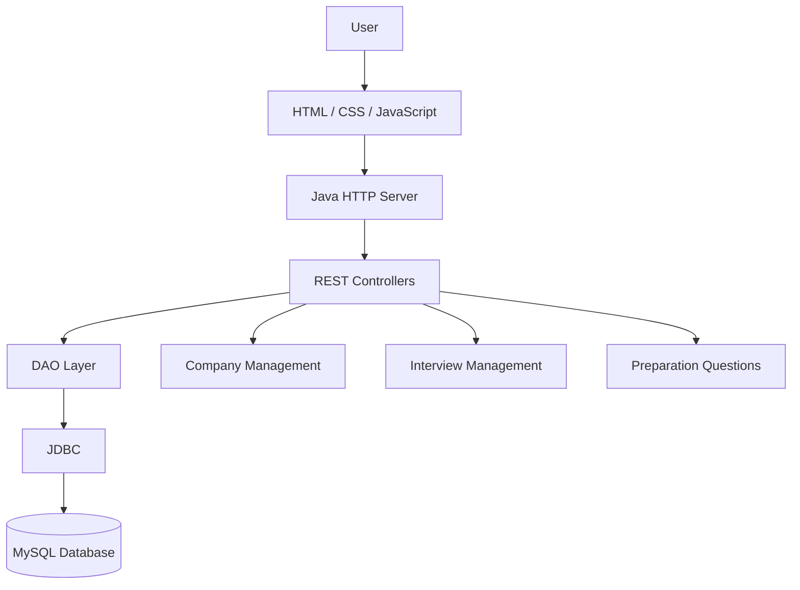

# Interview Preparation Tracker

A full-stack web application to organize job applications, manage interview rounds, and track technical preparation questions in one place.

## Features

### 1. Company Management
- Add and manage job applications.
- Store company names, job roles, locations, and job types.
- Track application statuses.
- View and update application details.
- Delete application records.

### 2. Interview Management
- Schedule and manage interview rounds.
- Associate interview rounds with companies.
- Store round names, types, dates, statuses, and feedback.
- Edit and delete interview rounds.
- Filter interview rounds by company.

### 3. Preparation Questions
- Build a personal technical and HR question bank.
- Organize questions by category.
- Save personal answer notes.
- Set question difficulty: Easy, Medium, or Hard.
- Mark questions as completed or pending.
- Edit and delete questions.
- Search and filter questions.
- Track preparation progress through dashboard statistics.

### 4. Dashboard
- View application statistics.
- Track interview progress.
- Monitor completed and pending preparation questions.

## Technology Stack

| Layer | Technologies |
|---|---|
| Frontend | HTML5, CSS3, JavaScript |
| Backend | Core Java, Java HTTP Server |
| Database | MySQL 8.4 |
| Database Connectivity | JDBC, MySQL Connector/J |
| JSON Processing | Jackson |
| Configuration | dotenv-java |
| Build Tool | Apache Maven |
| Environment | GitHub Codespaces / Docker |

## Project Architecture



## Project Structure

```text
Interview-Preparation-Tracker/
│
├── backend/
│   ├── pom.xml
│   └── src/main/java/com/mahesh/tracker/
│       ├── Main.java
│       ├── config/
│       │   └── DatabaseConfig.java
│       ├── controller/
│       │   ├── CompanyController.java
│       │   ├── InterviewRoundController.java
│       │   ├── QuestionController.java
│       │   └── StaticFileHandler.java
│       ├── dao/
│       │   ├── CompanyDAO.java
│       │   ├── InterviewRoundDAO.java
│       │   └── QuestionDAO.java
│       └── model/
│           ├── Company.java
│           ├── InterviewRound.java
│           └── Question.java
│
├── database/
│   └── schema.sql
│
├── frontend/
│   ├── index.html
│   ├── style.css
│   └── script.js
│
├── .env.example
├── .gitignore
├── docker-compose.yml
└── README.md
```

## Prerequisites

Install or configure:

- Java JDK 25
- Apache Maven
- Docker and Docker Compose
- Git

## Installation and Setup

### 1. Clone the repository

```bash
git clone https://github.com/mahesh001-sys/Interview-Preparation-Tracker.git

cd Interview-Preparation-Tracker
```

### 2. Configure environment variables

Create your local environment file:

```bash
cp .env.example .env
```

Open `.env` and replace the placeholder passwords with your own secure values.

Example configuration:

```env
MYSQL_ROOT_PASSWORD=your_local_root_password
MYSQL_PASSWORD=your_local_app_password
DB_HOST=localhost
DB_PORT=3306
DB_NAME=interview_tracker
DB_USER=tracker_user
```

**Important:** Never commit your `.env` file or expose database passwords publicly.

### 3. Start MySQL using Docker

From the project root:

```bash
docker compose up -d
```

Check the container:

```bash
docker compose ps
```

The MySQL service uses a persistent Docker volume to retain database data.

The database schema is initialized automatically when MySQL creates its data directory for the first time.

### 4. Build the backend

```bash
cd backend

mvn clean package
```

### 5. Start the application

Run the backend from the `backend` directory:

```bash
mvn exec:java
```

The application starts on port `8080`.

Open:

http://localhost:8080

In GitHub Codespaces, open port 8080 using the Ports tab and select the forwarded application URL.

**Important:** Run the backend from the `backend` directory because the application resolves its frontend files relative to that directory.

## API Endpoints

The backend exposes the following REST API routes:

| Module | HTTP Method | Endpoint | Purpose |
|---|---|---|---|
| Health | GET | `/api/health` | Check application and database health |
| Companies | GET | `/api/companies` | Retrieve companies |
| Companies | POST | `/api/companies` | Create a company |
| Companies | GET | `/api/companies/{id}` | Retrieve a company |
| Companies | PUT | `/api/companies/{id}` | Update a company |
| Companies | DELETE | `/api/companies/{id}` | Delete a company |
| Interview Rounds | GET | `/api/interview-rounds` | Retrieve interview rounds |
| Interview Rounds | POST | `/api/interview-rounds` | Create an interview round |
| Interview Rounds | GET | `/api/interview-rounds/{id}` | Retrieve an interview round |
| Interview Rounds | PUT | `/api/interview-rounds/{id}` | Update an interview round |
| Interview Rounds | DELETE | `/api/interview-rounds/{id}` | Delete an interview round |
| Questions | GET | `/api/questions` | Retrieve preparation questions |
| Questions | POST | `/api/questions` | Create a preparation question |
| Questions | GET | `/api/questions/{id}` | Retrieve a question |
| Questions | PUT | `/api/questions/{id}` | Update a question |
| Questions | DELETE | `/api/questions/{id}` | Delete a question |

### Health Check

```bash
curl http://localhost:8080/api/health
```

A successful response returns application status and database connectivity information.

## Database Design

The application uses MySQL with the following tables:

| Table | Purpose |
|---|---|
| `companies` | Stores job application information |
| `interview_rounds` | Stores interview rounds linked to companies |
| `questions` | Stores preparation questions and progress |
| `prep_notes` | Stores preparation notes linked optionally to companies |

### Relationships

- One company can have multiple interview rounds.
- Deleting a company deletes its associated interview rounds.
- Preparation notes can optionally reference a company.
- Deleting a company preserves its preparation notes by setting their company reference to NULL.

## Verification

Build the backend:

```bash
cd backend
mvn clean package
```

Check JavaScript syntax:

```bash
node --check frontend/script.js
```

Check database connectivity:

```bash
curl http://localhost:8080/api/health
```

## Security Notes

- Database credentials are stored in a local `.env` file.
- `.env` is excluded through `.gitignore`.
- `.env.example` contains placeholder values only.
- Database access is handled through JDBC.
- The frontend is served through the Java backend.

## Future Enhancements

- User authentication and authorization.
- Resume management.
- Interview reminders and notifications.
- Advanced preparation analytics.
- Export application and preparation reports.

## Author

**Mahesh Kumar**

B.Tech Information Technology Graduate

GitHub: [mahesh001-sys](https://github.com/mahesh001-sys)

---

If this project helps you, consider giving the repository a star!